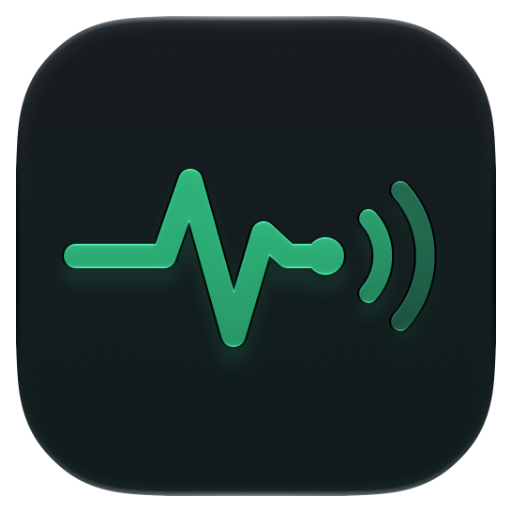
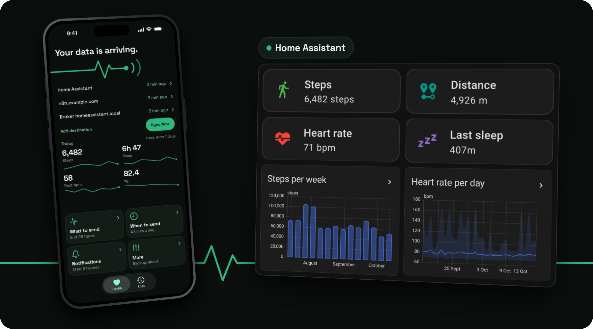
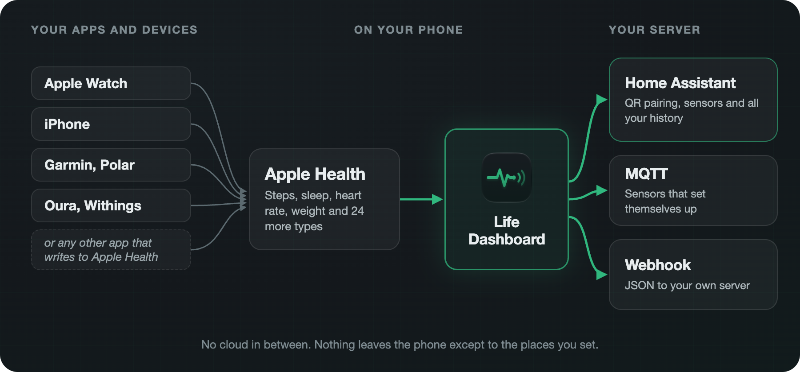
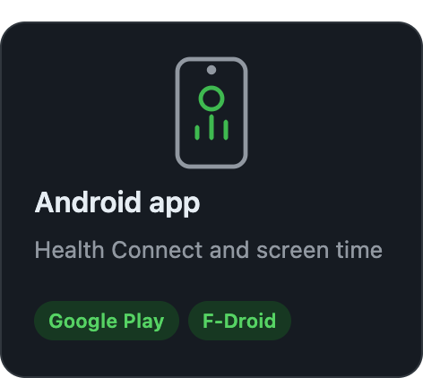
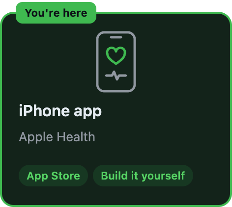
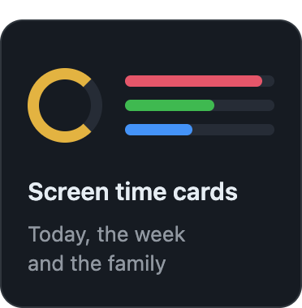
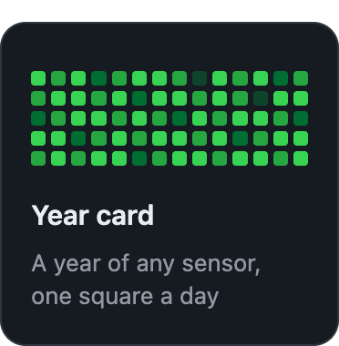
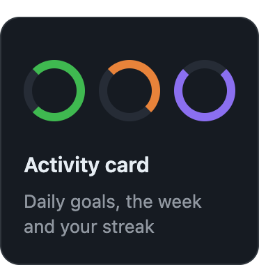
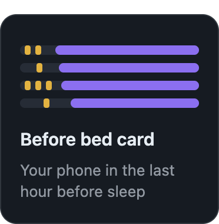

<p align="center">
  
</p>

<h1 align="center">Life Dashboard for iPhone</h1>

<p align="center">
  <b>Apple Health from your iPhone, sent to Home Assistant, MQTT or your own server.</b><br>
  Every source at once, with no account in between.
</p>

<p align="center">
  <a href="https://apps.apple.com/app/apple-store/id6824075761?pt=128699800&ct=gh-ios-readme&mt=8"></a><br>
  <sub>€6.99 (US$5.99) once. No subscription, no in-app purchases. Same code as this repo, or <a href="#build-it-yourself">build it yourself</a>.</sub>
</p>

<p align="center">
  <a href="https://my.home-assistant.io/redirect/hacs_repository/?owner=owen282000&repository=life-dashboard-ha&category=integration"></a>
  <a href="#install"></a>
  <a href="https://scorecard.dev/viewer/?uri=github.com/owen282000/life-dashboard-companion-app-ios"></a>
  <a href="LICENSE"></a>
</p>

<p align="center">
  <a href="#install">Install</a>
  &nbsp;·&nbsp;
  <a href="#build-it-yourself">Build&nbsp;it&nbsp;yourself</a>
  &nbsp;·&nbsp;
  <a href="docs/usage.md">Setup&nbsp;guide</a>
  &nbsp;·&nbsp;
  <a href="docs/webhook.md">Payload&nbsp;reference</a>
  &nbsp;·&nbsp;
  <a href="https://owen282000.com/life-dashboard/ios/">Website</a>
</p>

<!-- life-dashboard:nav -->
<p align="center">
  <sub>Life Dashboard: <a href="https://github.com/owen282000/life-dashboard-companion-app">Android app</a> &nbsp;·&nbsp; <b>iPhone app</b> &nbsp;·&nbsp; <a href="https://github.com/owen282000/life-dashboard-ha">Home Assistant integration</a> &nbsp;·&nbsp; <a href="https://github.com/owen282000/life-dashboard-stack">Grafana stack</a> &nbsp;·&nbsp; <a href="https://github.com/owen282000/life-dashboard-sleep-card">Sleep card</a> &nbsp;·&nbsp; <a href="https://github.com/owen282000/life-dashboard-screen-time-card">Screen time cards</a> &nbsp;·&nbsp; <a href="https://github.com/owen282000/life-dashboard-year-card">Year card</a> &nbsp;·&nbsp; <a href="https://github.com/owen282000/life-dashboard-activity-card">Activity card</a> &nbsp;·&nbsp; <a href="https://github.com/owen282000/life-dashboard-before-bed-card">Before bed card</a></sub>
</p>
<!-- /life-dashboard:nav -->

<p align="center">
  <picture>
    <source media="(max-width: 600px)" srcset="docs/readme-hero-phone.png">
    
  </picture><br>
  <sub>On the iPhone: Home Assistant, a webhook and an MQTT broker each delivered 3 minutes ago, with today's steps, sleep, resting heart rate and weight. In Home Assistant: steps and heart rate as sensors, and steps per week as a chart.</sub>
</p>

Your Apple Watch, iPhone, ring or scale already writes to Apple Health. This app sends that data, from every source at once, to Home Assistant, an MQTT broker or a webhook you run. There is no account in between, and none of it reaches me.

- Apple Watch, Garmin, Oura, Withings: if it writes to Apple Health, it arrives, with no cloud login and no developer app to register per brand.
- In Home Assistant all your history lands on the days it happened, paired with one QR code, and it stays when you change phones: the new phone can take over the old one's history.
- Deletions go out too, not only new records, so your server stays in step with Apple Health.
- Day totals add up: steps, distance and calories are Apple Health's own figure for the day, so a walk recorded by both iPhone and Watch counts once.
- An iPhone and an Android phone send the same payload, so a mixed household shares one Home Assistant integration or one database.
- Pay once, no subscription: the app is on the [App Store](https://apps.apple.com/app/apple-store/id6824075761?pt=128699800&ct=gh-ios-readme&mt=8) for €6.99 (US$5.99) once, or you build it from source yourself.
- Open source (MIT): the App Store app is this code, and you can build it yourself.
- Want to ask Claude or a local model in Ollama about your own history? The [Grafana stack](https://github.com/owen282000/life-dashboard-stack#ask-your-own-ai-mcp) adds an MCP server with eight read-only tools. The app itself contains no AI.

<a id="why-this-app"></a>

## What you get

- **28 data types.** Steps, sleep with stages, heart rate and HRV, weight and body composition, blood pressure, glucose, workouts, nutrition, VO2 max, cycle tracking and more. Together they read 74 Apple Health types (70 on iOS 17), because nutrition alone is 38 and distance is one per activity. Each data type is off until you switch it on, by hand or with **Essentials** or **All types**.
- **Every record, plus clean daily totals.** Every record goes out with the app or device that wrote it. Daily totals for steps, distance and calories come from Apple Health's own statistics, so a walk recorded by both iPhone and Watch counts once.
- **All your history.** Backfill from 30 days up to 5 years, or everything Apple Health has, in one go. In Home Assistant each day lands on its own date. When you delete a record in Apple Health, the next sync tells your server.
- **Runs in the background.** An interval or fixed times, on the days you pick, with quiet hours. iOS decides the exact moment, and most syncs come when you unlock the iPhone. For an exact time, a Shortcuts automation runs **Sync Health Data**. Payloads that can't be delivered wait on the iPhone for the next sync. When iOS holds syncs back (Background App Refresh off, Low Power Mode on) or nothing arrives for days, the app says so.
- **Widget, Control Center and Shortcuts.** See the last sync on your home screen, and sync from there, from Control Center (iOS 18 or newer) or with Siri.
- **Eleven languages:** English, Dutch, German, French, Spanish, Italian, Portuguese (Brazil), Japanese, Arabic, Hindi and Simplified Chinese. With Dynamic Type, Reduce Motion and dark mode.

## How it works

Apple Health is where your iPhone, Apple Watch and apps like Garmin Connect, Oura and Withings keep their data. This app reads from it in the background and sends the new records straight to the places you set up.

<p align="center">
  <picture>
    <source media="(max-width: 600px)" srcset="docs/how-it-works-phone.png">
    
  </picture>
</p>

Two things from the Android app aren't here. There's no screen time: the iPhone app sends none, so the Screen time cards are for Android phones. Apple shows the time per app only inside its own Screen Time extensions, which can't send anything out, so an app has nothing to read and pass on. And the app doesn't write readings back into Apple Health. [What iOS does differently](docs/features.md#what-ios-does-differently) lists every difference and why.

## Part of Life Dashboard

Life Dashboard is two apps, three places for the data to go and a set of cards for Home Assistant, and you only install the parts you need. Put the app on each phone, then pick where the data goes. Both apps send the same payload, so an Android phone and an iPhone can share one Home Assistant, one stack or one server of your own.

<p align="center">
  <b>On your phone</b><br>
  <a href="https://github.com/owen282000/life-dashboard-companion-app"><picture><source media="(prefers-color-scheme: light)" srcset="docs/family/android-light.png"></picture></a>
  <picture><source media="(prefers-color-scheme: light)" srcset="docs/family/ios-here-light.png"></picture>
</p>

<p align="center">
  <picture><source media="(prefers-color-scheme: light)" srcset="docs/family/arrow-light.png"></picture><br>
  <sub>sends your data to</sub>
</p>

<p align="center">
  <b>Where the data goes</b><br>
  <a href="https://github.com/owen282000/life-dashboard-stack"><picture><source media="(prefers-color-scheme: light)" srcset="docs/family/stack-light.png"></picture></a>
  <a href="https://github.com/owen282000/life-dashboard-ha"><picture><source media="(prefers-color-scheme: light)" srcset="docs/family/ha-light.png"></picture></a>
  <a href="https://owen282000.com/life-dashboard/health-connect-webhook/"><picture><source media="(prefers-color-scheme: light)" srcset="docs/family/own-server-light.png"></picture></a>
</p>

<p align="center">
  <picture><source media="(prefers-color-scheme: light)" srcset="docs/family/arrow-light.png"></picture>
</p>

<p align="center">
  <b>Cards for your Home Assistant dashboard</b><br>
  <sub>They need Home Assistant; most work with any sensor, and the integration fills them with your history.</sub><br>
  <a href="https://github.com/owen282000/life-dashboard-sleep-card"><picture><source media="(prefers-color-scheme: light)" srcset="docs/family/sleep-card-light.png"></picture></a>
  <a href="https://github.com/owen282000/life-dashboard-screen-time-card"><picture><source media="(prefers-color-scheme: light)" srcset="docs/family/screen-time-card-light.png"></picture></a>
  <a href="https://github.com/owen282000/life-dashboard-year-card"><picture><source media="(prefers-color-scheme: light)" srcset="docs/family/year-card-light.png"></picture></a>
  <a href="https://github.com/owen282000/life-dashboard-activity-card"><picture><source media="(prefers-color-scheme: light)" srcset="docs/family/activity-card-light.png"></picture></a>
  <a href="https://github.com/owen282000/life-dashboard-before-bed-card"><picture><source media="(prefers-color-scheme: light)" srcset="docs/family/before-bed-card-light.png"></picture></a>
</p>

<a id="quick-start"></a>
<a id="build-and-install"></a>

## Install

### What you need

- An iPhone on iOS 17 or newer.
- Home Assistant 2026.3 or newer, for the Life Dashboard integration. An MQTT broker or a webhook of your own works too, without the integration.
- Something that writes to Apple Health: the iPhone itself, an Apple Watch, or the app of your watch, ring or scale (Garmin Connect, Oura, Withings and so on).

### From the App Store

The app is listed on the App Store as **Health Data for Home Assistant**. It costs €6.99 (US$5.99) once, with no subscription and nothing to buy inside the app, and it is the same app as this source.

1. In Home Assistant, in **Settings > Marketplace** (HACS before Home Assistant 2026.11), install the [Life Dashboard integration](https://my.home-assistant.io/redirect/hacs_repository/?owner=owen282000&repository=life-dashboard-ha&category=integration). On HACS, download it and restart first.
2. Add the integration under **Settings > Devices & services**. It shows a pairing QR code.
3. Install the app from the [App Store](https://apps.apple.com/app/apple-store/id6824075761?pt=128699800&ct=gh-ios-readme&mt=8) on your iPhone, open it and scan the code when the setup asks where your data should go.
4. Pick your data types (**Essentials** is a good start) and allow Apple Health access for them.
5. The setup ends with a first sync. Later, **Sync Now** on the Health tab sends at once; otherwise the app syncs by itself.
6. Tap **Send history** under **What to send** to get your past data, from 30 days up to everything Apple Health has.

Every step of the setup can be skipped, so you can also install the app first and scan the code later with **Add destination**. Using MQTT or a webhook instead? Skip steps 1 and 2 and enter your broker or webhook URL in step 3.

You should now see your iPhone under **Settings > Devices & services > Life Dashboard**, with a sensor for each type it sent. If it stays empty:

- The type is switched off under **What to send**, or Apple Health access for it was declined. iOS never tells an app that you declined, so the type sends nothing: check the Health app under your profile, **Apps**, **Life Dashboard**.
- The iPhone was locked. Health data can't be read while it is locked, so unlock it and tap **Sync Now**.
- The app can't reach Home Assistant: you declined local network access, or you are away from home and the address in the code only works there. The Logs tab shows what each delivery answered.

The [setup guide](docs/usage.md) covers every step, and its [troubleshooting](docs/usage.md#troubleshooting) has the rest.

### Build it yourself

Building it from source costs nothing extra if you already have an Apple Developer Program membership. You need a Mac with Xcode 26 (the newest Xcode needs macOS 26.2; on macOS 15.6, Xcode 26.3 works), an iPhone on iOS 17 or newer, and a paid Apple Developer Program membership (US$99 a year): Apple doesn't give a free Apple Account the HealthKit capability the app needs. A build signed with a membership runs for a year.

1. Clone the repository, open `LifeDashboardCompanion.xcodeproj`, and set your own team, bundle identifiers and app group. The [setup guide](docs/usage.md#build-and-install) shows where each one goes.
2. Run it on your iPhone. The first time, iOS asks you to switch on Developer Mode and trust your certificate.
3. Set it up as the App Store app: follow the steps [above](#from-the-app-store), with your own build in place of the install in step 3.

To update a build of your own, pull the repository and run it from Xcode again. Your settings stay. **Preview payload** under **What to send** shows what goes out.

## Home Assistant

There are two ways in. Neither needs YAML.

| | Life Dashboard integration | MQTT |
|---|---|---|
| Setup | Marketplace, then scan a QR code | Enter your broker |
| Sensors | 20 of 28 types, blood pressure as two | The same |
| History | Every day, as far back as Apple Health has data, through backfill | From the first sync on |
| Workouts and mindfulness | The last workout and each session, with the heart rate, calories and distance recorded during it, and minutes per day | No |
| Sleep stages and food | Hours per sleep stage for every night, the last night's stages, and the calories, protein, carbs and fat you ate today | No |
| An Android phone too | Its own device next to it | Its own device and base topic |
| Example dashboard | Included; its screen time view is for Android | No |

Pick the integration unless you already run a broker and don't need the days before your first sync. Single meals and cycle tracking entries are events rather than values, so neither route turns them into sensors; the integration does add what was recorded during a workout to its workout sensors. A webhook of your own gets them in full. [Setup for both](docs/usage.md#phone-to-home-assistant) is in the guide, and [features.md](docs/features.md#home-assistant-and-mqtt) lists the MQTT sensors.

[](https://my.home-assistant.io/redirect/hacs_repository/?owner=owen282000&repository=life-dashboard-ha&category=integration)

<details>
<summary><b>Already use Home Assistant's Companion app?</b></summary>

<br>

Keep it. It does presence, notifications and device sensors, and this app doesn't try to. They work side by side.

Home Assistant's Companion app reads Apple Health too. Its Apple Health sensors ([#5272](https://github.com/home-assistant/iOS/pull/5272), [#5638](https://github.com/home-assistant/iOS/pull/5638)) cover steps, heart rate, weight, blood pressure, sleep stages and more, each as one sensor with today's total or the newest reading. Their history in Home Assistant starts the day you switch them on, and workout details, meals and cycle tracking aren't among them.

This app covers the health side in depth: 28 types, every record with the app or device that wrote it, all your history backfilled, each day on its own date, and MQTT or a webhook when Home Assistant isn't the only place it should go.

</details>

<a id="what-it-sends"></a>

## Webhooks

Any server that accepts a JSON POST can be a destination: n8n, Node-RED, a small script, or your own API. Each address has its own signing secret (HMAC-SHA256) and its own custom headers, so pairing a second receiver never breaks the first, and you can add a client certificate. Any receiver that shows a pairing code can be paired by scanning it, your own server included: [let your users connect health data with one QR code](https://owen282000.com/life-dashboard/health-data-qr-pairing/).

```json
{
  "timestamp": "2026-10-04T12:00:00Z",
  "app_version": "1.12.0",
  "source": "healthkit_ios",
  "sequence": 1842,
  "daily_totals": [
    {
      "date": "2026-10-04",
      "steps": 8421,
      "distance_meters": 6210.4
    }
  ],
  "steps": [
    {
      "count": 1234,
      "start_time": "2026-10-04T08:00:00Z",
      "end_time": "2026-10-04T09:00:00Z",
      "uuid": "5B7A0C2E-8F3D-4B1A-9C6E-2D4F8A1B3C5D",
      "source": "Alex's Apple Watch"
    }
  ]
}
```

This example is shortened. The keys, units and signing are the Android app's. Every raw record has a `uuid` to deduplicate on and a `source`, the name of the app or device that wrote it. [webhook.md](docs/webhook.md) lists what an iPhone sends and where it differs from Android. The Android app's [payload reference](https://github.com/owen282000/life-dashboard-companion-app/blob/main/docs/webhook.md) documents every type and has receivers to start from, and its [JSON Schema](https://github.com/owen282000/life-dashboard-companion-app/blob/main/docs/webhook-schema.json) covers both apps.

If you have no backend yet, the [Grafana stack](https://github.com/owen282000/life-dashboard-stack) is an example Docker Compose setup: a receiver that checks the signature, Postgres, and a Grafana dashboard. It's a one-person project offered as-is, built to be changed.

## Ask your own AI

Want to ask an AI how your sleep changed in the weeks you walked more? The [Grafana stack](https://github.com/owen282000/life-dashboard-stack#ask-your-own-ai-mcp) keeps every record in Postgres and has an MCP server with eight read-only tools, for Claude, a local model in Ollama or any other MCP client. Already on Home Assistant or your own Postgres? The [recipe](https://github.com/owen282000/life-dashboard-companion-app/blob/main/docs/recipes/ask-your-own-llm.md) has a route for each, without the stack. The app itself sends nothing to any AI: the data only goes where you point it.

## Privacy

The app has no analytics, no crash reporting and no ads, and there's no Life Dashboard server. Your data goes from the iPhone to the destinations you set and nowhere else. Webhooks use HTTPS. iOS allows plain HTTP only to an IP address, a .local name or a name without a dot, meant for your own network. The app only asks Apple Health for read access, and secrets stay in the iOS Keychain. [PRIVACY.md](PRIVACY.md) lists everything the app reads, sends and keeps. iOS gives you no way to check that an App Store build matches this source. If that matters to you, build it yourself: it's free, and the app has no third-party dependencies.

<!-- life-dashboard:built -->
## How this is built

Life Dashboard is a one-person project, and [Claude Code](https://claude.com/claude-code) writes a large part of the code. I decide what gets built, read every change before it is merged, and test it on my own phones and Home Assistant before a release. Automated checks run on every pull request, and the [AI policy](https://github.com/owen282000/life-dashboard-companion-app/blob/main/AI_POLICY.md) explains what the AI does and what I check.
<!-- /life-dashboard:built -->

## Documentation

**Get started:** [Setup guide](docs/usage.md) · [Troubleshooting](docs/usage.md#troubleshooting)

**Reference:** [All features](docs/features.md) · [What iOS does differently](docs/features.md#what-ios-does-differently) · [Payload](docs/webhook.md) · [Settings backup](docs/settings-backup.md)

**Project:** [Building and releasing](docs/building.md) · [Translations](docs/localization.md) · [Contributing](CONTRIBUTING.md) · [Changelog](CHANGELOG.md) · [Privacy](PRIVACY.md) · [Security](SECURITY.md)

**From the Android app:** [Full payload reference](https://github.com/owen282000/life-dashboard-companion-app/blob/main/docs/webhook.md) · [JSON Schema](https://github.com/owen282000/life-dashboard-companion-app/blob/main/docs/webhook-schema.json) · [Ask your own LLM about your history](https://github.com/owen282000/life-dashboard-companion-app/blob/main/docs/recipes/ask-your-own-llm.md)

## Help and contributing

Questions go to the Android app's [Discussions](https://github.com/owen282000/life-dashboard-companion-app/discussions), which cover both apps; say that it's about the iPhone. Bugs go to [issues](https://github.com/owen282000/life-dashboard-companion-app-ios/issues/new/choose) here. [SUPPORT.md](.github/SUPPORT.md) explains which is which. No GitHub account? Use the [feedback board](https://owen282000.com/life-dashboard/feedback/), which needs no account. Everything on it is public, so leave out health data, logs and webhook URLs.

Pull requests are welcome. The app is Swift with no third-party dependencies. [CONTRIBUTING.md](CONTRIBUTING.md) covers the checks CI runs, and [building.md](docs/building.md) gets you a working build.

## Acknowledgments

- [HealthKit](https://developer.apple.com/documentation/healthkit) by Apple, which this app reads from, and Apple's SwiftUI, BackgroundTasks, Network, WidgetKit and App Intents frameworks. The app has no third-party dependencies.
- The [Android app](https://github.com/owen282000/life-dashboard-companion-app), whose payload, schedule format and settings backup this app follows
- The typefaces Space Grotesk and Space Mono, under the SIL Open Font License
- The quantified self and self-hosting communities

## Support the project

Stars, shares and good bug reports all help. This is a one-person project, but your setup doesn't depend on that person: there's no server of mine to switch off, your history lives in your own Home Assistant or database, and the code is MIT. If you want to chip in for the evenings that go into it, there's [Ko-fi](https://ko-fi.com/owen282000). The code stays open source, and building it yourself stays free, either way.

MIT licensed. See [LICENSE](LICENSE).

<!-- life-dashboard:footer -->
<p align="center">
  <sub>Made by <a href="https://github.com/owen282000">Owen Vogelaar</a> for the self-hosting and quantified self crowd.</sub><br>
  <sub>Google Play and the Google Play logo are trademarks of Google LLC.</sub><br>
  <sub>Apple, the Apple logo and App Store are trademarks of Apple Inc.</sub>
</p>
<!-- /life-dashboard:footer -->
