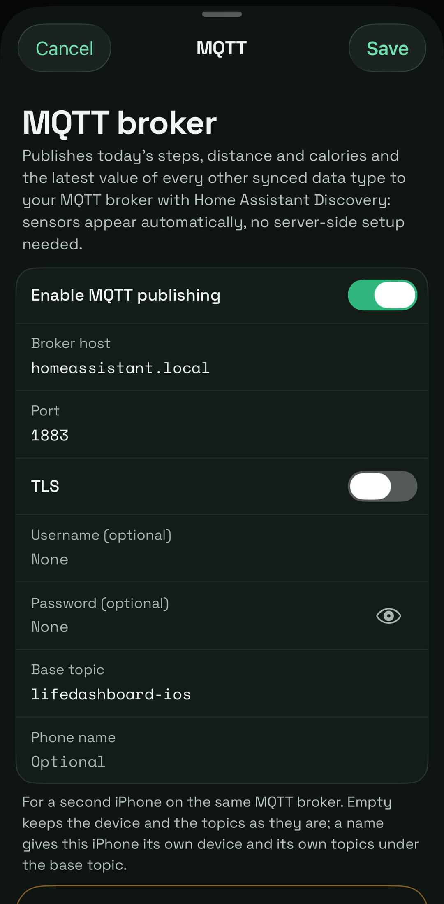
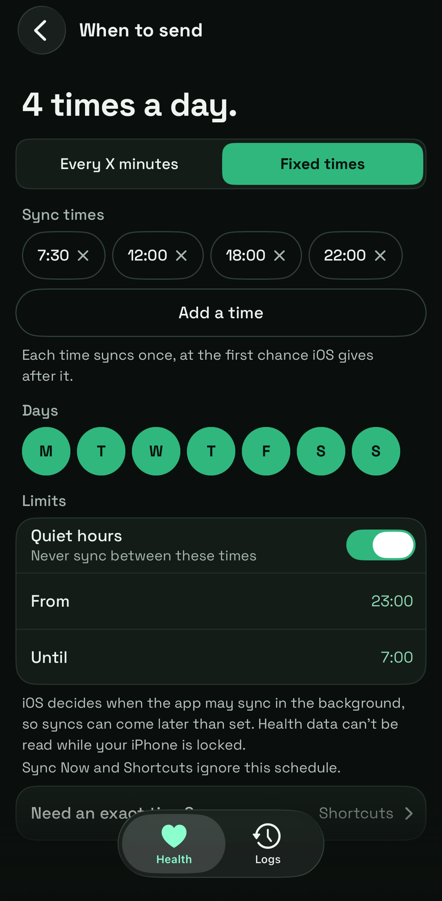
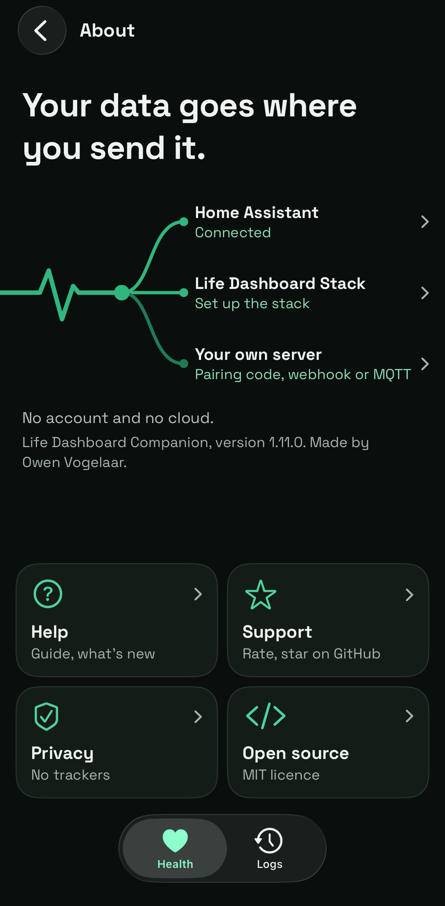

# Features

Everything Life Dashboard Companion for iOS does, in detail. For building and setup see [usage.md](usage.md); for the payload your server receives see [webhook.md](webhook.md).

## Apple Health

Reads Apple Health (HealthKit) and sends it to your webhooks, the Home Assistant integration or MQTT. Every type starts off and has its own switch under **What to send**, and iOS asks for access to it the first time you switch it on.

### 28 supported data types

| Category | Types |
|---|---|
| Activity | Steps, Distance, Active Calories, Total Calories, Exercise Sessions |
| Body | Weight, Height, Body Fat, Lean Body Mass |
| Heart and vitals | Heart Rate, Resting Heart Rate, Heart Rate Variability, Blood Pressure, Oxygen Saturation, Respiratory Rate, Body Temperature, Basal Body Temperature, Blood Glucose, VO2 Max |
| Sleep and mind | Sleep (sessions with stages), Mindfulness (sessions from apps that write them to Apple Health) |
| Food and drink | Hydration, Nutrition (per food: energy, protein, carbohydrates, fat and 34 more nutrients) |
| Cycle tracking | Menstruation (flow, plus periods derived from it), Intermenstrual Bleeding, Ovulation Test, Cervical Mucus, Sexual Activity |

These are the Apple Health types that have a counterpart in the Android app, under the Android app's payload keys. Menstruation sends both flow and periods, so the 28 switches cover 29 of the Android app's 33 types. The four that stay out (bone mass, body water mass, skin temperature and basal metabolic rate) have no Apple Health type that means the same; [webhook.md](webhook.md#what-ios-sends) says why for each.

One data type can read several Apple Health types: Nutrition reads 38, Distance one per activity. Together the 28 read 74 Apple Health types, or 70 on iOS 17, which has fewer distance types.

Every category also has a **Not available yet** list, with what Apple Health has and the app does not read. A page of its own, **Not available yet**, names what has no category because the app has no type in it: **Symptoms** and **Sound, daylight and habits**, names only, nothing to switch. **Missing a type?** starts an issue to name the one you want.

- **Essentials, All types and Custom** - **Essentials** is steps, distance, active calories, sleep, heart rate, resting heart rate, weight and exercise sessions. **All types** switches on every type, cycle tracking included. Any other selection is **Custom**. A preset never loses your own choice: **Custom** brings it back, and it travels with the settings backup
- **Incremental sync** - each sync sends the records added since the last one, per type, from HealthKit's own change tracking, also when they are dated in the past. **Sync Now** sends what is new too, as in the Android app, in up to 8 rounds while a type is catching up past its limit, and publishes the newest value of every type to MQTT. **Backfill** sends history
- **Bounded payloads** - at most 1000 records per sync for heart rate, steps and total calories, 500 for HRV and respiratory rate, and 200 for the rest. The next sync continues where this one stopped
- **Fault isolation** - a type that cannot be read is skipped, and the rest of the sync goes ahead. When no type answers at all, the sync fails with a row in the Logs tab instead of reporting no new data, as in the Android app
- **Daily totals** - per-day steps, distance and calories as the Health app counts them, with overlapping iPhone and Watch data counted once, in the Android app's `daily_totals` format. **Daily totals in payload** under **More > Advanced** switches it off
- **Deleted records** - a record deleted in Apple Health is named in `deleted_records`, so a receiver can drop it. See [webhook.md](webhook.md#deletions)
- **Data resolution** - under **What to send**, per type, every record or one value per 1, 5 or 15 minutes, or per hour, as in the Android app: heart rate, HRV, oxygen saturation and respiratory rate are averaged with their minimum and maximum, steps, distance and both calories are summed. Windows align to the clock and say how many samples went in; a window still filling is held until it closes, so an automatic sync sends it once, whole. Everything starts at every record. See [webhook.md](webhook.md#data-resolution)

## History

- **Backfill**, **Send history** under **What to send**, sends 30 or 90 days, 6 months, 1, 2 or 5 years, or **All history** from the oldest record of the enabled types, of every enabled type to your webhooks, in 3-day windows, oldest first, with the Android app's backfill fields. The list says how many chunks each length takes and the month All history starts in, and leaves out a length that reaches back past the oldest record. The Home Assistant integration takes in about the last year for now
- Progress is kept per window: **Pause** stops after the window in flight, and **Resume** continues at the first window that was not delivered in full
- It runs while the app is open and the iPhone is unlocked, and keeps the screen on meanwhile. On iOS 26 it runs as a continued processing task instead, which keeps going when you switch apps and shows its progress in the system UI
- Backfill payloads go to webhooks only, never to MQTT or the retry queue

## Webhook configuration

- **Pairing by QR code** - any receiver that shows a code, such as the [Home Assistant integration](https://github.com/owen282000/life-dashboard-ha) (0.7.1 or newer), the [Life Dashboard Stack](https://github.com/owen282000/life-dashboard-stack) or [a server of your own](https://owen282000.com/life-dashboard/health-data-qr-pairing/). **Scan a pairing code** under **Add destination** fills in the address and the signing secret after one confirmation. See [Pairing by QR code](usage.md#pairing-by-qr-code)
- **Multiple webhook URLs** - send to several endpoints at once; a sync counts as delivered when one of them accepted it
- **Every address its own secret and headers** - tap a destination on the Health tab for its HMAC signing secret and its headers (auth tokens, API keys or any other HTTP header), stored in the Keychain. Generate a secret, or copy one or the headers from another address, while the field is empty. Pairing sets only the paired address's secret, so a second receiver never breaks the first. A header HTTP cannot carry (a space in the name, a line break in the value) is refused when you add it
- **HMAC payload signing** - an optional `X-Signature` header per address, the Android app's scheme, so your server can verify the sender
- **Send test** - on a destination's sheet and on the Logs tab, sends a small test payload to check your server without waiting for real data
- **Retries with backoff** - transient failures are retried; permanent errors fail at once
- **Retry queue** - every payload is queued on the phone before it is sent, so a sync that iOS cuts off loses nothing. One that was not delivered is sent again when the network comes back, at the next sync, or with **Retry Now**, to the URLs and with the headers configured at that moment. A payload the receiver refuses (HTTP 400, 413 or 422) does not hold up the ones after it and is tried again once a day. A payload older than 7 days is dropped when the receiver answers its next delivery with an error, never while the iPhone is offline, and the queue holds up to 700, as in the Android app. A dropped payload gets a row in the Logs tab and a notification
- **HTTPS, and plain HTTP on the home network** - iOS allows `http://` only to an IP address, a `.local` name or a name without a dot
- **Client certificates (mTLS)** - import a `.p12` file under **More > Advanced**, and every webhook whose server asks for a certificate gets it, also in the background, for a receiver behind a reverse proxy that requires one. It stays in this iPhone's Keychain. See [usage.md](usage.md#a-server-that-requires-a-client-certificate)

Delivery details, retry rules and signature verification are in [webhook.md](webhook.md#delivery-retries-and-signing).

## Home Assistant and MQTT

Two ways in. The [Life Dashboard integration](https://github.com/owen282000/life-dashboard-ha) takes the webhook directly and keeps the history in long-term statistics; [usage.md](usage.md#phone-to-home-assistant) explains how to set it up.

MQTT is the other way, for a setup that already runs a broker:

- **Home Assistant Discovery** - the app publishes a sensor per synced type, grouped under one device, with no YAML
- **21 sensors for 20 of the 28 types** - Steps Today, Distance Today, Active Calories Today and Total Calories Today, and the latest heart rate, resting heart rate, HRV, last sleep duration, weight, height, blood glucose, oxygen saturation, body temperature, basal body temperature, respiratory rate, body fat, lean body mass, VO2 max, blood pressure (systolic and diastolic) and hydration
- **Today's totals** - the four day sensors hold today's total as the Health app counts it, with iPhone and Watch counted once, under the Android app's names and units, with state class `total_increasing` and the day in a `date` attribute. They come from today's `daily_totals` entry, read for MQTT even when **Daily totals in payload** is off. Hydration holds the newest record, and its name says "(latest record)", as on Android
- **Android's decimals** - each state has the fixed number of decimals the Android app's sensor has, so it reads the same on both and does not change between publishes: whole numbers for heart rate and the day totals, whole minutes for sleep, two decimals for height, blood glucose and hydration, one for the rest, blood pressure included (`121.0`)
- **Retired sensors** - versions up to 1.4.1 published steps, distance and calories as "(latest record)" sensors; every publish now removes them from the broker, and with them from Home Assistant
- **Webhook only** - exercise, nutrition, mindfulness and the cycle tracking types are events rather than values, and a retained topic is no place for reproductive data
- **A destination of its own** - a broker without a webhook URL is enough, as in the Android app. **Sync Now**, the automatic syncs and the **Sync Health Data** action all publish, and the observers and background tasks start as soon as a broker is set, without reopening the app
- **Every sync with new records publishes** every sensor in the app's sensor cache, as the Android app does, with today's totals and the new values on top, so a new broker sees the whole device at once. A type that is still catching up past the per-sync cap keeps the value it had until it has caught up, and a value older than the one the sensor holds, such as a weight entered for last week, never replaces it. Sync Now's values, the newest of each type, replace the cached ones, so a value deleted in Apple Health leaves the sensor. Sync Now reads a type with more records in the week than its cap again from the newest end
- **A sensor cache instead of a queue** - the app keeps the newest value of each sensor it publishes, out of backups and encrypted like the retry queue, and removes them at the next sync after MQTT is switched off. A sync with nothing new publishes them again when the broker, port, TLS, base topic or phone name changed since the last publish, or when that publish failed or was cut off, then at most every 30 minutes, so a broker at home is not dialled by every wakeup while the iPhone is out. A day total from an earlier day is not sent as today's. The cache starts empty on the update that brings it and fills with the next records of each type, or at once with **Sync Now**
- **No deletions, no backfill** - deleted records and backfill payloads go to webhooks only. A webhook URL added after a time with only a broker gets what is new from then on; **Send history** sends what came before
- States and discovery configs are published retained; TLS and a username and password are optional, and the password is kept in the Keychain
- Its own device id and base topic (`lifedashboard-ios`), so an iPhone never collides with the Android app's sensors in the same household
- **Phone name** - for a second iPhone on the same broker, as in the Android app. Without a name the device and topics stay as they are; a name gives this iPhone its own device (`life_dashboard_companion_ios_<name>`) and topics (`lifedashboard-ios/<name>/<sensor>/state`). After a rename the next publish removes the old device's retained topics from the broker
- A built-in MQTT 3.1.1 client on Network.framework, so the app has no third-party dependencies

## Sync scheduling

- **Two modes** - under **When to send**, **Every X minutes** (at least 15, 60 by default) or **Fixed times**, stored in the Android app's format
- **A time means "not before"** - iOS decides when an app runs in the background, so a fixed time syncs once, at the first chance iOS gives after it. A time missed until quiet hours, or on a day that is off, is skipped rather than moved
- **Weekday filter** - any subset of days
- **Quiet hours** - never sync between two times; queued payloads wait too
- The screen warns when a combination never syncs, and a line on the Health tab says why automatic syncs are waiting
- **Need an exact time?** - a Shortcuts Time of Day automation runs **Sync Health Data** at the minute you set; the app explains how
- **Sync Now** and the Shortcuts action ignore the schedule
- Schedules travel with the settings backup

## Background sync

Each of these is a chance to sync. It asks the schedule first, and syncs only when one is due:

1. **HealthKit background delivery** - HealthKit wakes the app when an enabled type has new data. Apple limits how often: step count, for example, at most once an hour
2. **App refresh task** - iOS runs it at a moment of its own choosing after the next scheduled sync
3. **Processing task** - the same, when the iPhone is idle
4. **Opening the app and unlocking the iPhone**

Each sends only what is new. Health data cannot be read while the iPhone is locked, so a sync that iOS starts then waits for the unlock.

## Automation

- **Shortcuts and Siri** - a **Sync Health Data** action, for a Shortcuts automation at a set time, on arriving home, or by voice. It sends what is queued and what is new, to the webhooks and the MQTT broker
- **Home screen widget** - the last sync result, records delivered today, and a status mark, so a failing background sync shows. Its button syncs now
- **Control Center** - on iOS 18 and later, a **Sync Now** control for Control Center, the Android app's Quick Settings tile. It needs an unlocked iPhone, as every sync does
- The widget button, the control and the Shortcuts action run **Sync Health Data**, and together sync at most once a minute, like the Android app's sync broadcast: a tap within a minute of the last accepted one does nothing
- **Failure notifications** - under **Notifications**, a tile on the Health tab and a row under **More**: a local notification after a number of failed syncs in a row, which you choose, and one when nothing was delivered for two days or a day past the next scheduled sync, whichever is later. That one is set ahead after every delivery, so it also comes when iOS no longer wakes the app
- **When iOS holds syncs back** - a card on the Health tab while Background App Refresh is off for the app (Open Settings, Help for your phone, Don't show again), a line while Low Power Mode is on, and since when nothing was delivered when that is longer than the schedule explains

## Data tools

- **Preview payload** - under **What to send**, the exact JSON payload before it is sent. **Copy JSON** puts all of it on the clipboard, for this iPhone only and for 2 minutes, up to 1 MB; **Share** hands it over as a .json file
- **Export data** - under **More**, what Preview payload shows, with **Export JSON** as a JSON file or **Export CSV** as CSV with a row per record and a column per field, through the share sheet. The file is written to the app's temporary folder, which is not backed up, and only the newest export is kept there
- **Logs** - every webhook delivery and MQTT publish with its status, error and payload, the last 100 entries. An MQTT failure says in plain words what went wrong (host not found, connection refused, no answer, TLS, login refused); iOS's own error text is under Details. Filter by **All**, **Failed**, **Webhook** or **MQTT**, and tap a row for its details. **Copy payload** and **Share payload** give a delivery's whole payload, as in the preview
- **Sync history** - on the Logs tab: the success rate and the last success at the top, and under them, to fold out, deliveries and records and the three latest failures grouped by receiver and error. A delivery that iOS cut off, as when it ends a background task, shows as Interrupted and counts as neither a success nor a failure; its payload is queued for retry like a failed one
- **Export logs** - **Export** on the Logs tab gives the log as CSV or JSON, through the share sheet. **Clear** deletes it after a confirmation
- **Settings backup and restore** - under **More > Backup and restore**, the webhooks, headers, signing secret, schedule, MQTT settings and data types as a JSON file, in the Android app's format, so a file moves between an iPhone and an Android phone. See [settings-backup.md](settings-backup.md)

## General

- **The Health tab** - a heading that says how it is going, a row per destination with its last delivery, **Add destination**, **Sync Now**, **Today**, and the tiles **What to send**, **When to send**, **Notifications** and **More**
- **Today** - only what you send: steps, sleep, resting heart rate and weight with a line for the last 7 days, for those of the four that are selected and have data. With none of them, the records sent today. Cycle tracking never shows here
- **First-run setup** - what the app does, where the data goes (the pairing scanner, a webhook with a **Test ping**, or an MQTT broker), which types (**Essentials** is picked already, next to **All types** and **Choose later**), and Apple Health access as a step of its own, followed by a first sync that shows its result. Every step can be skipped, and a setup left halfway comes back at the next start
- **About** - under **More**: where your data can go, and **Help** (the setup guide, documentation, what's new, reporting a problem), **Support** (**Rate the app** for the App Store, a star on GitHub), **Privacy** (the privacy policy) and **Open source** (the code, the licence and **Connect your own receiver**)
- **Asking for a rating** - once per version, a few days after first use and only at a good moment: the last sync reached every address and nothing is failing or queued, or a backfill just finished. Apple shows the prompt at most three times a year and decides itself whether it appears
- **Privacy policy in the app** - under **More > About > Privacy**, a summary of [PRIVACY.md](../PRIVACY.md)
- **Languages** - English, Dutch, German, French, Spanish, Italian, Portuguese (Brazil), Japanese, Arabic (right to left), Hindi and Simplified Chinese, following the iPhone's language or the one set for the app under Settings. See [localization.md](localization.md)
- **SwiftUI** - with Dynamic Type, Reduce Motion and dark mode; **Appearance** under **More** follows the system or keeps the app light or dark
- **No third-party dependencies** - only Apple's frameworks

## What iOS does differently

The payload is the Android app's, but an iPhone is not an Android phone. Where iOS cannot do something, this says so; where the app simply does not do it, it says that instead.

- **No Screen Time.** iOS cannot send it anywhere. Apple's Screen Time API only shows usage inside a device activity report extension, which runs in a sandbox that cannot make network requests or move data out (Apple, [DeviceActivityReport](https://developer.apple.com/documentation/deviceactivity/deviceactivityreport)). There is no Screen Time tab and no `screen_time` payload.
- **iOS decides when the app runs.** No iOS app can run at a chosen minute in the background. HealthKit wakes the app on new data, with a minimum interval per type, and iOS runs background tasks when it sees fit. Background App Refresh does not run in Low Power Mode or when it is switched off for the app. A fixed time is "not before"; for an exact time, use a Shortcuts automation.
- **A locked iPhone cannot be read.** iOS encrypts Apple Health while the iPhone is locked (Apple, [Protecting user privacy](https://developer.apple.com/documentation/healthkit/protecting-user-privacy)). A sync that starts then waits for the unlock, and a backfill pauses.
- **No writing into Apple Health.** The app asks for read access only, so the Android app's receiving from Home Assistant (a scale or blood pressure monitor written into Health Connect) is not built on iOS.
- **A client certificate comes from a file.** The Android app picks one from Android's credential store. iOS gives apps no such picker, and a certificate installed as a profile in Settings is for Safari and Apple's own apps, so the app imports a `.p12` file into its own Keychain instead.
- **Record source.** `source` is the name HealthKit gives the writing app or device, not a package name.
- **No diagnostics.** The Android app's `_diagnostics` block is not built on iOS. See [what iOS does not send](webhook.md#what-ios-does-not-send).
- **App Store or Xcode.** The app is on the [App Store](https://apps.apple.com/app/life-dashboard-companion/id6824075761) as a one-time purchase. Building it yourself with Xcode is the free alternative; see [usage.md](usage.md#build-and-install).

## Tech stack

- **Swift and SwiftUI** - iOS 17 or later
- **HealthKit** - anchored queries, statistics queries and background delivery
- **BackgroundTasks** - app refresh, processing and, on iOS 26, continued processing tasks
- **URLSession** - webhook delivery with retries
- **Network framework** - the MQTT client and connectivity monitoring
- **App Intents and WidgetKit** - the Shortcuts action, the home screen widget and the Control Center control
- **CryptoKit and CommonCrypto** - HMAC signing and the encrypted settings backup
- **AVFoundation** - the pairing code scanner
